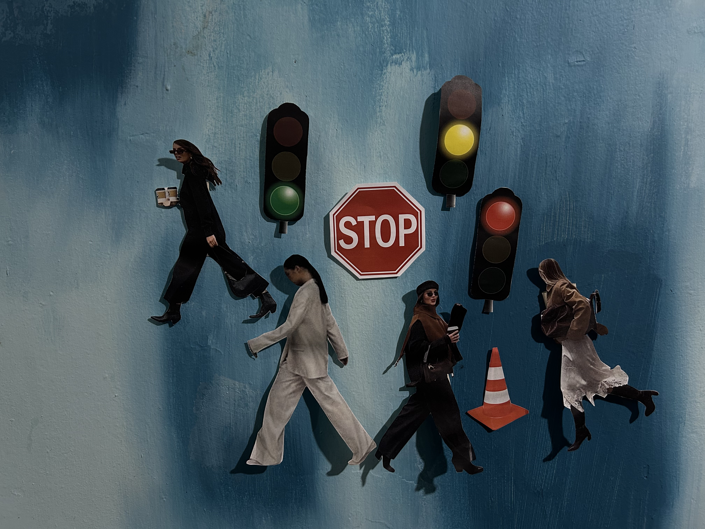

# Recolección del Dataset y Captura Nativa
{: .fs-9 }

Estrategia de adquisición de datos utilizando la óptica nativa del QCar para optimizar el entrenamiento de redes neuronales convolucionales.
{: .fs-6 .fw-300 }

---

La calidad y representatividad de los datos son los factores más críticos en el desarrollo de un modelo de percepción visual. Para este proyecto, se diseñó un pipeline de recolección de imágenes enfocado en maximizar la precisión en el entorno real de despliegue.

## 1. Justificación del Método de Captura

En lugar de utilizar dispositivos externos (como teléfonos móviles o cámaras reflex) para fotografiar los objetos de prueba, se tomó la decisión arquitectónica de **capturar el 100% del dataset directamente a través de la cámara del QCar**. 

Esta estrategia técnica ofrece ventajas fundamentales para el aprendizaje del modelo:
- **Consistencia Óptica:** El modelo (YOLOv8) aprende a extraer características basándose exactamente en el mismo campo de visión (FOV), distorsión de lente y perfil de color (balance de blancos y exposición) con el que operará durante la navegación autónoma.
- **Resolución Nativa:** Las imágenes se capturan y guardan en la resolución objetivo de `640x480` píxeles. Esto elimina la necesidad de aplicar algoritmos de interpolación o escalado profundo (*downsampling*) que podrían degradar la información espacial de las señales.
- **Eficiencia de Preprocesamiento:** Al evitar fotos externas de alta resolución (ej. 4K de un smartphone), se reduce drásticamente el peso del dataset y se elimina la necesidad de aplicar recortes o post-procesamiento manual antes de subir los datos al servidor de entrenamiento.

## 2. Clases y Objetos de Estudio

Para simular un entorno de tráfico urbano (ADAS), se definieron 6 clases principales. Los objetos fueron impresos y escalados proporcionalmente para ser detectados a nivel de suelo por el chasis del robot.

Las clases a detectar son:
1. **Señal de Alto** (Stop)
2. **Semáforo en Verde**
3. **Semáforo en Amarillo**
4. **Semáforo en Rojo**
5. **Cono de Tránsito** (Obstáculo)
6. **Peatones** (4 variantes o siluetas distintas)

<p align="center">
  
  <br>
  <em>Figura 1: Conjunto completo de objetos y señalizaciones utilizados para la recolección de datos y validación del sistema autónomo.</em>
</p>

## 3. Desarrollo del Script de Captura

Para agilizar el proceso de recolección, se desarrolló un script en Python ejecutado de forma nativa en la Jetson Nano. Este código inicializa la API de Quanser a 30 FPS y queda a la escucha de eventos del teclado (`ESPACIO` para capturar). 

Una característica clave de este script es su **sistema de guardado seguro**: lee el directorio antes de iniciar y ajusta dinámicamente el contador de imágenes (`img_counter = max + 1`). Esto permite detener y reanudar la captura en diferentes sesiones sin riesgo de sobreescribir datos valiosos.

```python
import cv2
import os
from Quanser.pal.utilities.vision import Camera2D

def main():
    # --- CONFIGURACIÓN DEL DIRECTORIO ---
    save_dir = "dataset_yolo"
    if not os.path.exists(save_dir):
        os.makedirs(save_dir)

    # --- EVITAR SOBREESCRIBIR FOTOS (Lógica de autoincremento) ---
    existing_files = os.listdir(save_dir)
    existing_images = [f for f in existing_files if f.startswith("captura_") and f.endswith(".png")]
    
    if existing_images:
        # Extrae los números de los nombres de archivo y encuentra el más alto
        last_numbers = [int(f.replace("captura_", "").replace(".png", "")) for f in existing_images]
        img_counter = max(last_numbers) + 1
    else:
        img_counter = 0

    # --- INICIALIZACIÓN DE CÁMARA ---
    cam = Camera2D(cameraId="3", frameWidth=640, frameHeight=480, frameRate=30.0)

    print("--- Recolector de Dataset QCar ---")
    print(f"Las imágenes se guardarán en: ./{save_dir}/")
    print(f"-> Iniciando contador de fotos en: {img_counter} <-")
    print("Mueve el robot o tu hoja impresa. Presiona ESPACIO para capturar.")
    print("Presiona 'q' en la ventana de video para salir.\n")

    try:
        while True:
            ok = cam.read()
            if ok:
                # Se toma el frame original intacto para la red neuronal
                frame_limpio = cam.imageData.copy()
                
                # Se crea una copia exclusiva para la interfaz gráfica (UI)
                frame_display = frame_limpio.copy()
                
                # Overlay de telemetría en el live feed
                cv2.putText(frame_display, f"Fotos tomadas: {img_counter}", (20, 40), 
                            cv2.FONT_HERSHEY_SIMPLEX, 1, (0, 255, 0), 2)
                
                cv2.imshow("Recolector de Dataset", frame_display)

                key = cv2.waitKey(1) & 0xFF
                
                # Acción al presionar ESPACIO (ASCII 32)
                if key == 32:
                    # Se guarda el frame_limpio (sin el texto sobrepuesto)
                    img_name = os.path.join(save_dir, f"captura_{img_counter:04d}.png")
                    cv2.imwrite(img_name, frame_limpio)
                    print(f"[+] ¡Foto {img_counter} guardada exitosamente!")
                    img_counter += 1
                    
                # Acción al presionar 'q' (Quit)
                elif key == ord('q'):
                    print("\nCerrando recolector...")
                    break

    except KeyboardInterrupt:
        pass
    finally:
        cam.terminate()
        cv2.destroyAllWindows()

if __name__ == "__main__":
    main()
```